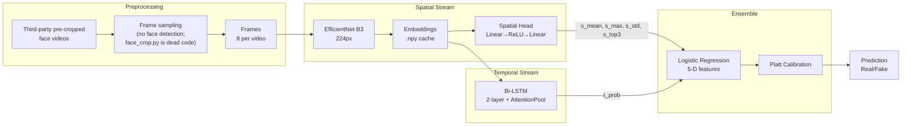
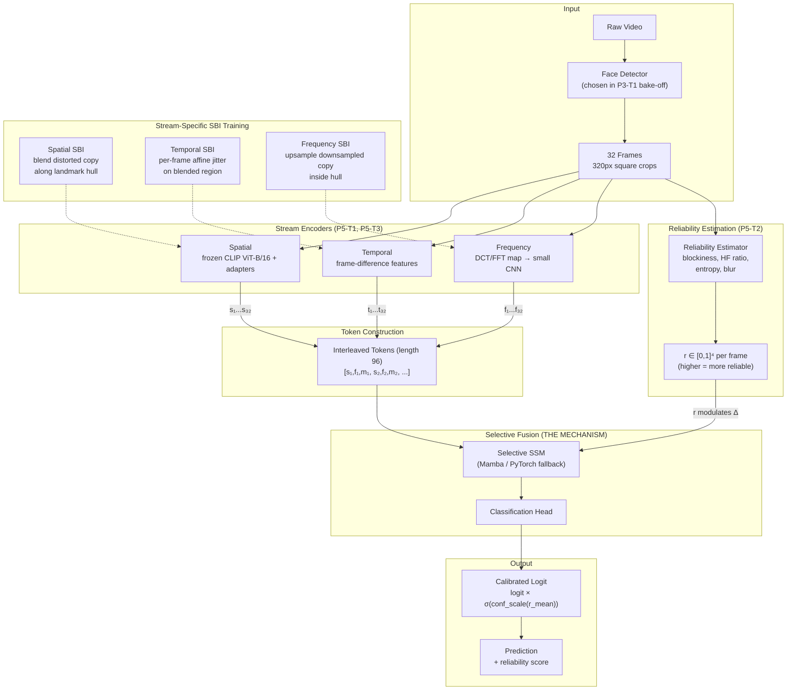
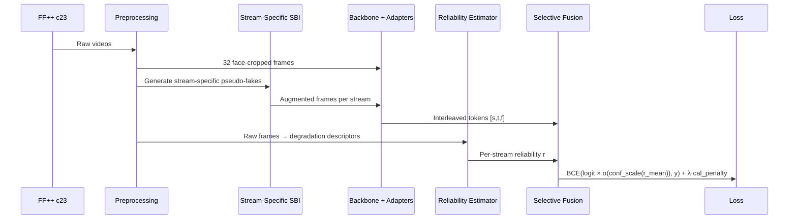
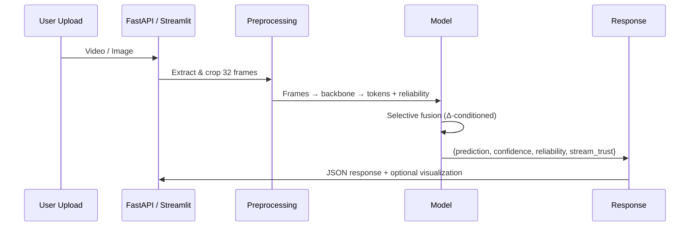
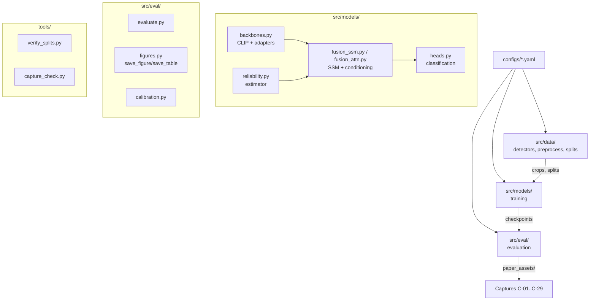

# System Architecture

## Overview

This document describes both the **current (legacy)** and **target** architectures for the
deepfake detection system. The target architecture implements reliability-conditioned selective
fusion — the paper's core contribution.

---

## Current Architecture (Legacy Capstone)



**Known Issues** (see `RESEARCH_ANALYSIS.md` §1.2):
- 905 Celeb-DF entries in the split lists (never used for training — verified 2026-11-28)
- Spatial-head checkpoint never loaded into the ensemble (prefix mismatch, `strict=False`)
- 8 frames per video (insufficient for temporal claims)
- No face detection of its own — relied on third-party crops
- EfficientNet-B3 at 224px (native is 300)
- No frequency stream
- LogisticRegression fusion (no learned dynamics)

---

## Target Architecture (Reliability-Conditioned Selective Fusion)



### The Core Mechanism (P5-T3)

```
Δ_t = softplus(W_Δ x_t + b_Δ + W_rel[k] r_t)

Where:
- W_Δ, b_Δ: standard Mamba selection projection
- W_rel[k]: Linear(4, d_model), one per stream k, zero-initialized (invariant 7)
- r_t:      4-D reliability descriptor of the frame token t comes from (shared by its 3 tokens)
B and C are also FiLM-conditioned per stream: B_t = B_t · (1 + γ_B[k](r_t)), γ_B[k] zero-init.
```

**Why Δ?** In selective SSMs, Δ controls how much each input token writes to hidden state.
Low reliability → small Δ → token passes through without accumulating in memory.
High reliability → large Δ → token's evidence is retained.

This means **degradation-awareness and sequence modeling are the same operation**, not two
bolted-together contributions.

---

## Data Flow — Training



---

## Data Flow — Inference



---

## Module Dependency Graph



---

## Config Inheritance

All configs live in `configs/` as flat YAML files. No inheritance chain — each config is
self-contained for its phase, except that `fusion_ssm.yaml` names the `backbone_clip.yaml` and
`reliability.yaml` it uses. The `operator` key in `fusion_ssm.yaml` is the only value
that is written by one task (P0-T1) and read by many.
