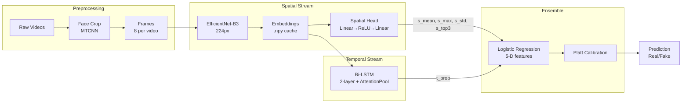
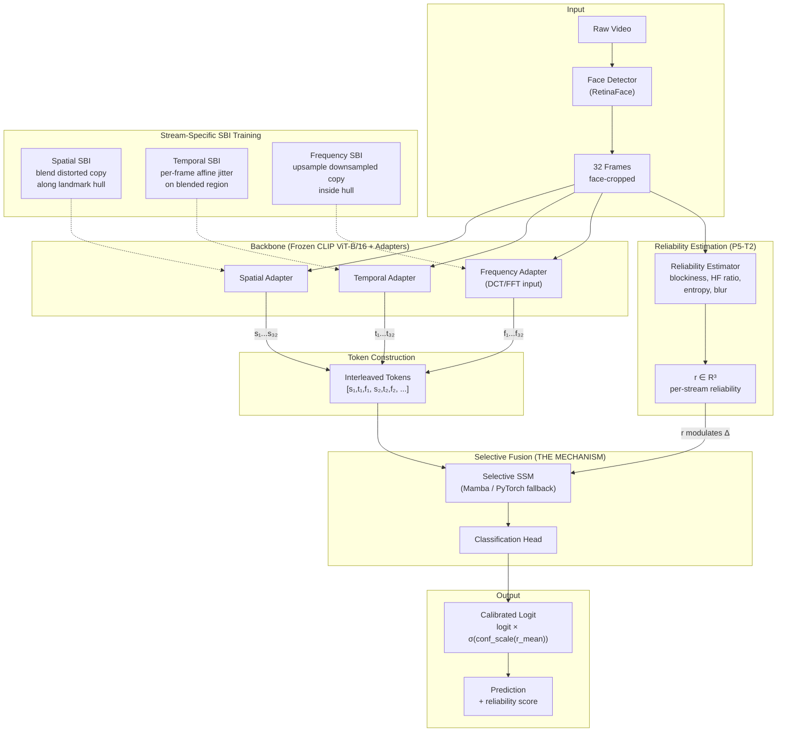
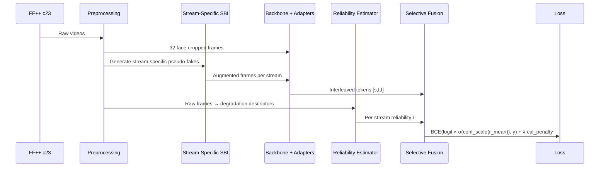
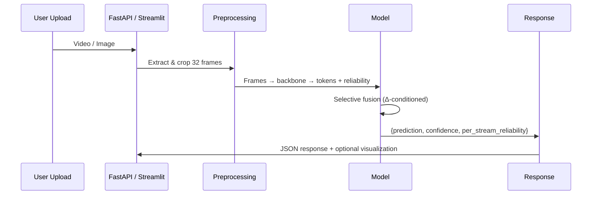
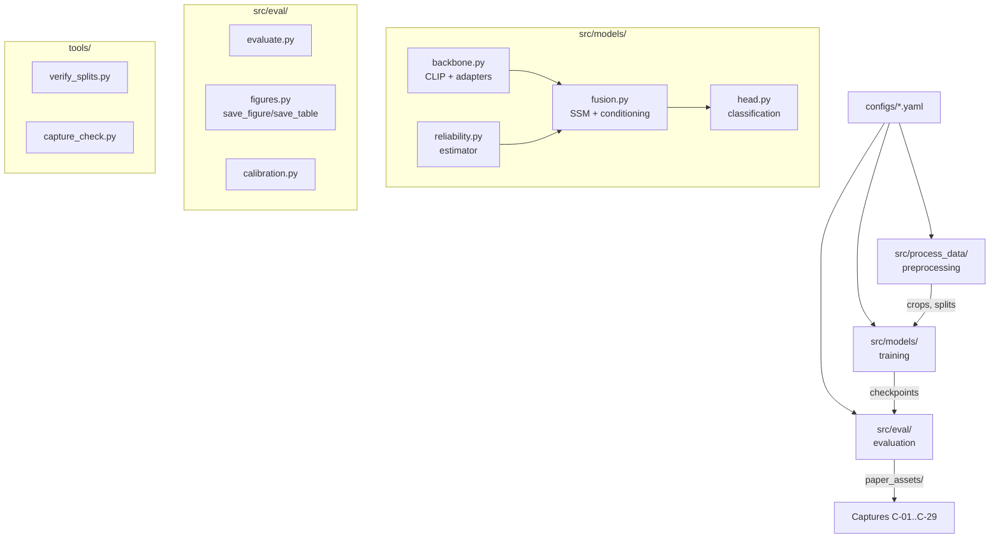

# System Architecture

## Overview

This document describes both the **current (legacy)** and **target** architectures for the
deepfake detection system. The target architecture implements reliability-conditioned selective
fusion — the paper's core contribution.

---

## Current Architecture (Legacy Capstone)



**Known Issues** (see `RESEARCH_ANALYSIS.md` §1.2):
- 905 Celeb-DF videos in training data (data leakage)
- 8 frames per video (insufficient for temporal claims)
- EfficientNet-B3 at 224px (native is 300)
- No frequency stream
- LogisticRegression fusion (no learned dynamics)

---

## Target Architecture (Reliability-Conditioned Selective Fusion)



### The Core Mechanism (P5-T3)

```
Δ_conditioned = Δ_base + W_rel · r_stream

Where:
- Δ_base:   learned base selection rate
- W_rel:    zero-initialized weight (invariant 7)
- r_stream: reliability score for this token's stream
```

**Why Δ?** In selective SSMs, Δ controls how much each input token writes to hidden state.
Low reliability → small Δ → token passes through without accumulating in memory.
High reliability → large Δ → token's evidence is retained.

This means **degradation-awareness and sequence modeling are the same operation**, not two
bolted-together contributions.

---

## Data Flow — Training



---

## Data Flow — Inference



---

## Module Dependency Graph



---

## Config Inheritance

All configs live in `configs/` as flat YAML files. No inheritance chain — each config is
self-contained for its phase. The `operator` key in `fusion_ssm.yaml` is the only value
that is written by one task (P0-T1) and read by many.
